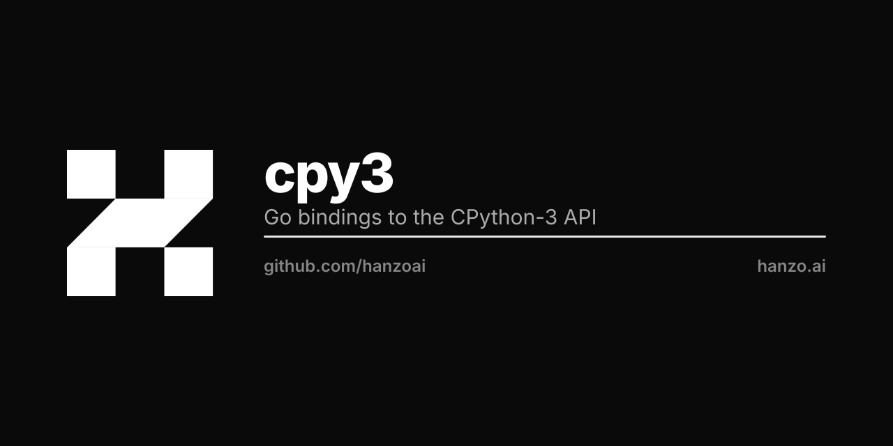

<p align="center"></p>

# Go bindings for the CPython-3 C-API (Hanzo fork)

**Supports Python 3.11, 3.12, 3.13, 3.13t (free-threaded).**

> Hanzo fork of [`go-python/cpy3`](https://github.com/go-python/cpy3)
> with Python 3.12+ compat, sub-interpreter wrapper (PEP 684),
> free-threading detection (PEP 703), a JSON hot-path helper for
> embedding contracts, and a script that builds free-threaded
> CPython 3.13t locally. See [`HANZO_CHANGES.md`](HANZO_CHANGES.md)
> for the diff against upstream. All credit for the original
> bindings goes to the go-python team; license remains MIT.

## What this fork adds (TL;DR)

- **Python 3.12 / 3.13 compat** — removed-API polyfills via `macro.h`
  so the same Go source links against 3.11 → 3.13t with no changes.
- **`SubInterpreter`** — Go wrapper around `Py_NewInterpreterFromConfig`
  (PEP 684 OWN_GIL by default). One sub-interp per concurrent tenant.
- **`IsGILDisabled()`** — runtime check for `Py_GIL_DISABLED` builds
  (PEP 703 free-threading).
- **`LoadSource` + `CallJSONFunctionByName`** — single-cgo-crossing
  helpers for the common "JSON-in, JSON-out" extension embedding
  contract. Faster and stack-safer than the long form for sustained
  high-throughput.
- **`scripts/build-python313t.sh`** — idempotent local build of
  free-threaded CPython 3.13.x.

This package provides a ``go`` package named "python" under which most of the
``PyXYZ`` functions and macros of the public C-API of CPython have been
exposed. Theoretically, you should be able use https://docs.python.org/3/c-api
and know what to type in your ``go`` program.

## relation to `DataDog/go-python3`

This project is a community maintained successor to [`DataDog/go-python3`](https://github.com/DataDog/go-python3), which will get archived in December 2021.

- If you use the Go package `github.com/DataDog/go-python3` in your code, you can use `github.com/go-python/cpy3` as a drop-in replacement. We intend to not introduce breaking changes.
- If you have unmerged PRs or open issues on `DataDog/go-python3`, please re-submit them here.

## relation to `sbinet/go-python`

This project was inspired by [`sbinet/go-python`](https://github.com/sbinet/go-python) (Go bindings for the CPython-2 C-API).

# Install

## Deps

We will need `pkg-config` and a working `python3.7` environment to build these
bindings. Make sure you have Python libraries and header files installed as
well (`python3.7-dev` on Debian or `python3-devel` on Centos for example)..

By default `pkg-config` will look at the `python3` library so if you want to
choose a specific version just symlink `python-X.Y.pc` to `python3.pc` or use
the `PKG_CONFIG_PATH` environment variable.

## Go get

```
go get github.com/hanzoai/cpy3
```

Then in your code:

```go
import python3 "github.com/hanzoai/cpy3"
```

## Sub-interpreters (PEP 684)

On Python 3.12+, use the sub-interpreter wrapper for tenant / per-worker
isolation with true parallelism:

```go
si, err := python3.NewSubInterpreter(python3.DefaultSubInterpreterConfig())
if err != nil { /* ... */ }
defer si.Close()

si.Enter()
defer si.Leave()
// ... any python3.* call now targets this sub-interpreter ...
```

See `subinterp.go` for the full API.

## JSON hot path

For the common "JSON-pipe extension" embedding contract (host sends a
JSON document, Python function processes, host receives JSON back),
use the consolidated `LoadSource` + `CallJSONFunctionByName` helpers.
Each `CallJSONFunctionByName` is ONE cgo crossing — the entire
`json.loads(payload) → fn(parsed) → json.dumps(result)` chain runs
in libpython:

```go
import (
    "log/slog" // or your preferred structured logger; see note below
    "runtime"

    "github.com/luxfi/log"
    python3 "github.com/hanzoai/cpy3"
)

func runHook(src, payload string) (string, error) {
    runtime.LockOSThread()
    defer runtime.UnlockOSThread()

    python3.Py_InitializeEx(false)
    si, err := python3.NewSubInterpreter(python3.DefaultSubInterpreterConfig())
    if err != nil {
        return "", err
    }
    defer si.Close()

    si.Enter()
    defer si.Leave()

    if err := python3.LoadSource(src); err != nil {
        log.Error("load python source", "err", err)
        return "", err
    }

    out, err := python3.CallJSONFunctionByName("handle", payload)
    if err != nil {
        log.Error("python hook failed", "err", err)
        return "", err
    }
    log.Info("python hook ok", "bytes_in", len(payload), "bytes_out", len(out))
    return out, nil
}
```

`luxfi/log` is the canonical Hanzo Go logger. The helpers don't
depend on it — that's just the example wiring. The cpy3 API surface
itself has no logger dependency.

# API

Some functions mix go code and call to Python function. Those functions will
return and `int` and `error` type. The `int` represent the Python result code
and the `error` represent any issue from the Go layer.

Example:

`func PyRun_AnyFile(filename string)` open `filename` and then call CPython API
function `int PyRun_AnyFile(FILE *fp, const char *filename)`.

Therefore its signature is `func PyRun_AnyFile(filename string) (int, error)`,
the `int` represent the error code from the CPython `PyRun_AnyFile` function
and error will be set if we failed to open `filename`.

If an error is raise before calling th CPython function `int` default to `-1`.

Take a look at some [examples](examples) and this [tutorial blogpost](https://poweruser.blog/embedding-python-in-go-338c0399f3d5).

# Contributing

Contributions are welcome! See [details](CONTRIBUTING.md).  


# Community
Find us in [`#go-python`](https://gophers.slack.com/archives/C4FDJLLET) on [Gophers Slack](https://gophers.slack.com). ([infos](https://blog.gopheracademy.com/gophers-slack-community/) | [invite](https://invite.slack.golangbridge.org/))  
  
This project follows the [Go Community Code of Conduct](https://golang.org/conduct).